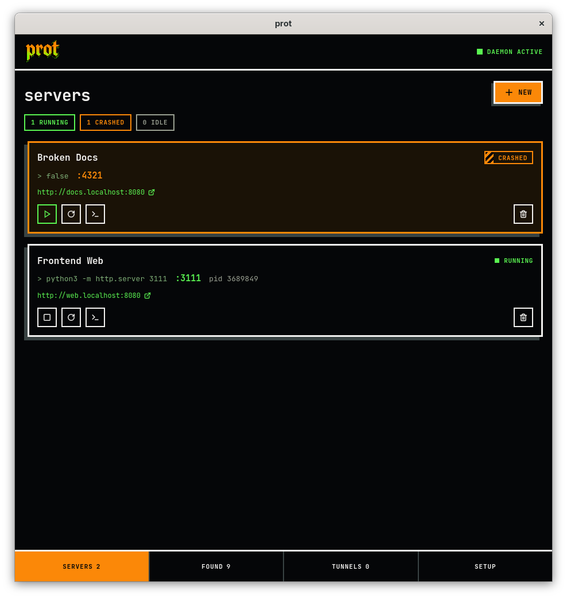
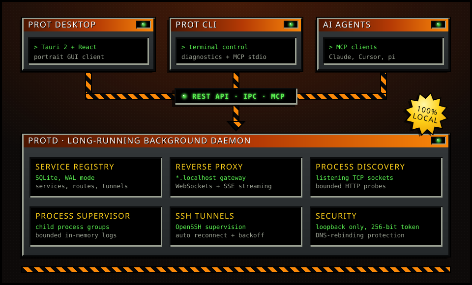

<h1 align="center">
  <a href="https://prot.adityagupta.dev"></a>
</h1>

<p align="center">
  <b>Stable <code>.localhost</code> URLs and one control plane for all your development servers.</b>
</p>

<p align="center">
  <a href="https://github.com/terastal-hq/prot/releases"></a>
  <a href="https://github.com/terastal-hq/prot/blob/main/go.mod"></a>
  <a href="https://aur.archlinux.org/packages/prot"></a>
  <a href="https://github.com/terastal-hq/prot/blob/main/docs/support-matrix.md"></a>
  <a href="https://github.com/terastal-hq/prot/blob/main/LICENSE"></a>
</p>

Prot is a local-first developer utility and control plane that discovers, organizes, routes, and manages development services, whether they run locally or through remote SSH connections.

It provides stable service identities and addresses (`http://<alias>.localhost`) independent of underlying process IDs, TCP ports, and infrastructure locations.

<p align="center">
  &nbsp;&nbsp;&nbsp;
  
</p>


Install the `prot` CLI, background daemon (`protd`), and systemd/launchd service with a single command:

```bash
curl -fsSL https://prot.adityagupta.dev/install | bash
```

Or take a package for your system:

<p align="center">
  <a href="https://github.com/terastal-hq/prot/blob/main/docs/installation.md#arch-linux-aur"></a>
  <a href="https://github.com/terastal-hq/prot/releases/download/v0.2.0/prot_0.2.0_linux_amd64.deb"></a>
  <a href="https://github.com/terastal-hq/prot/releases/download/v0.2.0/prot_0.2.0_linux_amd64.rpm"></a>
  <a href="https://github.com/terastal-hq/prot/releases/download/v0.2.0/prot_0.2.0_aarch64.dmg"></a>
</p>

For other architectures, the desktop installers (`.AppImage`, `.deb`), and build instructions, see the **[Installation Guide](docs/installation.md)**.

<br />
<br />


<p align="center">
  
</p>

- **`protd`**: Long-running background daemon managing process discovery, reverse proxy routing, OpenSSH tunnels, and SQLite registry.
- **`prot`**: Fast, lightweight CLI for terminal control, diagnostics, and MCP stdio adapter.
- **Prot Desktop**: Tauri 2 + React + TypeScript first-party dashboard.
- **REST & MCP API**: Loopback management API with 256-bit token authentication and DNS-rebinding protection.


### 1. Inspect System & Diagnostics
```bash
prot doctor
```

### 2. Discover Listening Development Services
Find running Vite, Next.js, Python, or backend servers automatically:
```bash
prot discover
```

### 3. Register and Supervise a Managed Service
```bash
# Register a dev server with a stable alias
prot add "Frontend Web" --cmd "npm run dev" --alias "web" --port 3000

# Start the service
prot start web

# Reach your service via stable .localhost URL
open http://web.localhost:8080
```

### 4. View Real-Time Logs
```bash
prot logs web -f
```

### 5. Reach a Remote Port Through SSH
```bash
# http://staging-db.localhost:8080 now reaches port 5432 on the bastion, and reconnects by itself
prot tunnel add staging-db --host deploy@bastion.example.com --remote-port 5432 --auto-connect
prot tunnel ls
```
`--host` takes a machine name from your `~/.ssh/config` too (`prot ssh ls` lists them, and the desktop app offers
them in a dropdown). Authenticate with ssh-agent or a key, or add `--password` to keep a password in your OS keyring. See
[SSH tunnels](docs/tunnels.md) for what to set up first (keys and host keys).

### 5. Check Daemon Status & Routes
```bash
prot status
```


Prot natively implements the **Model Context Protocol (MCP)**. AI agents (such as Claude Desktop, Cursor, or pi) can discover your local services, verify health, and ensure required endpoints are running.

### Automatic Setup Prompt for AI Coding Agents

Paste this prompt directly into your AI coding assistant (Claude Code, Cursor, pi, Cline, Windsurf, etc.) to configure prot automatically:

> "Add prot as an MCP server in my agent configuration. Configure it with command `prot` and arguments `["mcp"]`. If writing to a config file like claude_desktop_config.json or mcp.json, register it under `mcpServers.prot`."

### Manual Configuration

Add to your MCP configuration file (e.g. `claude_desktop_config.json`):

```json
{
  "mcpServers": {
    "prot": {
      "command": "prot",
      "args": ["mcp"]
    }
  }
}
```

`prot mcp` is a thin bridge: it relays each message to the running `protd` over the authenticated loopback API,
so agents see the same services, logs and process state as the CLI and the desktop app. Processes an agent starts
belong to the daemon and keep running when the agent disconnects. If `protd` is not running, tool calls fail with
a clear error until it is (`systemctl --user start protd`).

### Available MCP Tools

Tools that target a service take `id_or_alias`.

- `list_services`: Discover available local services.
- `get_service`: Read service state and launch configuration.
- `get_service_url`: Obtain the canonical `.localhost` URL.
- `get_service_logs`: Retrieve bounded recent stdout/stderr logs.
- `ensure_running`: Idempotently start a required service if not running.
- `start_service`, `stop_service`, `restart_service`: Process controls.
- `set_alias`: Change a service's `.localhost` alias (takes `id_or_alias` and `alias`).
- `list_tunnels`, `start_tunnel`, `stop_tunnel`: See and control saved SSH tunnels (agents cannot create or edit them).


- **[Installation Guide](docs/installation.md)** — One-line installer, binary packages, background service management.
- **[SSH tunnels](docs/tunnels.md)** — Setup, commands, reconnection and troubleshooting.
- **[Window Managers](docs/window-managers.md)** — Floating rules for niri, sway, i3 and Hyprland.
- **[Platform Support Matrix](docs/support-matrix.md)** — Operating system tiers and hardware capabilities.
- **[OpenAPI Specification](schemas/openapi.yaml)** — Complete REST API contract.


Run the Go unit test suite:
```bash
go test -v ./...
```

Run the end-to-end integration acceptance test:
```bash
./scripts/test_e2e.sh
```


MIT © [Terastal HQ](https://github.com/terastal-hq)
